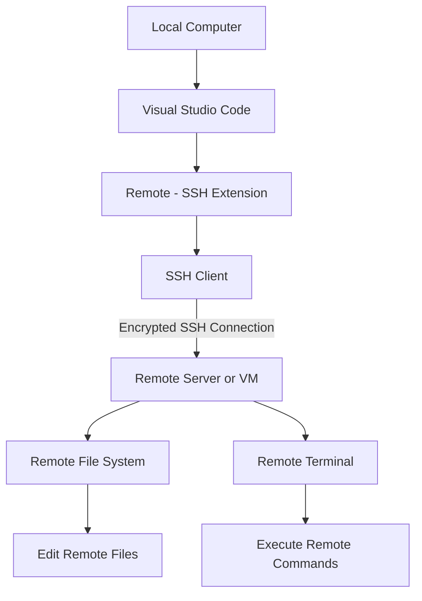

# VS Code for Beginners — Home Lab Edition

> New to VS Code? This guide walks you through everything you need to get comfortable using it — from installing it for the first time to writing scripts, navigating files, and customizing your setup. No prior experience needed.

---

## Table of Contents

1. [What is VS Code?](#what-is-vs-code)
2. [Installing VS Code](#installing-vs-code)
3. [Opening VS Code for the First Time](#opening-vs-code-for-the-first-time)
4. [Understanding the Interface](#understanding-the-interface)
5. [Opening Files and Folders](#opening-files-and-folders)
6. [Editing Files](#editing-files)
7. [The Command Palette — Your Best Friend](#the-command-palette--your-best-friend)
8. [The Integrated Terminal](#the-integrated-terminal)
9. [Extensions — Adding Superpowers](#extensions--adding-superpowers)
10. [Package Managers — Installing Tools Easily](#package-managers--installing-tools-easily)
11. [Customizing Your Settings](#customizing-your-settings)
12. [Working with Git and GitHub](#working-with-git-and-github)
13. [Connecting to a Remote Machine via SSH](#connecting-to-a-remote-machine-via-ssh)
14. [Helpful Keyboard Shortcuts](#helpful-keyboard-shortcuts)
15. [Tips for Home Lab Work](#tips-for-home-lab-work)
16. [Further Reading](#further-reading)

---

## What is VS Code?

**Visual Studio Code (VS Code)** is a free code editor made by Microsoft. Think of it like Microsoft Word, but for writing code and scripts instead of documents.

It works on both Windows and macOS and is one of the most popular tools used by IT professionals, developers, and home lab enthusiasts.

For home lab work, you'll use it to:

- Write and edit scripts (PowerShell, Bash, Python, etc.)
- Edit configuration files (YAML, JSON, `.conf`, etc.)
- Connect to remote machines and edit files directly
- Run commands in a built-in terminal without switching windows

---

## Installing VS Code

### Windows

1. Go to [code.visualstudio.com](https://code.visualstudio.com).
2. Click **Download for Windows**.
3. Run the downloaded `.exe` file.
4. During installation, enable:
   - **Add "Open with Code" action to Windows Explorer file context menu**
   - **Add to PATH (requires shell restart)**
5. Click **Install** and finish.

> **Why check those boxes?** The first lets you right-click a folder and open it in VS Code. The second lets you type `code .` in a terminal to open the current folder.

### macOS

1. Go to [code.visualstudio.com](https://code.visualstudio.com).
2. Click **Download for Mac**.
3. Open the downloaded `.zip` file.
4. Drag **Visual Studio Code.app** into **Applications**.
5. Open VS Code.
6. Press `Cmd+Shift+P`.
7. Type `shell command`.
8. Select **Shell Command: Install 'code' command in PATH**.

> This lets you type `code .` in Terminal to open a folder in VS Code.

---

## Opening VS Code for the First Time

When you first open VS Code, you'll see the **Welcome** tab.

You can close it after reviewing the getting-started information.

The first thing you should do is open a folder to work in.

Think of a folder as your project. Everything related to your work lives there.

### Open a Folder

**Windows:**

`File → Open Folder`

**macOS:**

`File → Open Folder`

You can also drag a folder onto the VS Code icon in your Dock.

Once a folder is open, you'll see its files in the left panel.

---

## Understanding the Interface

Here's a simplified map of the VS Code interface:

```text
┌────────────────────────────────────────────────────────────┐
│                         Title Bar                          │
├─────┬───────────────────┬──────────────────────────────────┤
│     │                   │                                  │
│  A  │     Side Bar      │                                  │
│  c  │                   │                                  │
│  t  │  File Explorer    │          Editor Area             │
│  i  │  Search Results   │                                  │
│  v  │  Source Control   │       Open files go here         │
│  i  │  Extensions       │                                  │
│  t  │                   │                                  │
│  y  │                   ├──────────────────────────────────┤
│     │                   │                                  │
│  B  │                   │       Integrated Terminal        │
│  a  │                   │                                  │
│  r  │                   │                                  │
└─────┴───────────────────┴──────────────────────────────────┘
```

### Activity Bar

The Activity Bar contains icons used to switch between VS Code features.

| Icon | What It Opens |
|------|---------------|
| 📄 Files | Explorer — browse files and folders |
| 🔍 Search | Search across project files |
| 🔀 Source Control | Manage Git and GitHub |
| 🧩 Extensions | Install additional VS Code features |
| 🖥️ Remote Explorer | Connect to remote machines |

### Editor Area

The Editor Area is where you read and write files.

You can:

- Open multiple files in tabs
- Split the editor into multiple panels
- Compare files side by side
- Edit scripts and configuration files

### Integrated Terminal

The integrated terminal lets you run commands without leaving VS Code.

**Shortcut:**

`Ctrl + Backtick`

You can run PowerShell, Bash, Python, and other supported shells.

---

## Opening Files and Folders

### Open a File

Use:

`File → Open File`

Or click a file in the Explorer panel.

### Open a Folder (Recommended)

Always open a project folder rather than individual files when possible.

This gives you access to the complete file structure.

**Steps:**

1. Click **File**.
2. Select **Open Folder**.
3. Navigate to your project folder.
4. Click **Select Folder**.

### Create a New File

1. Open the Explorer panel.
2. Click **New File**.
3. Enter a filename.

Examples:

```text
myscript.ps1
notes.txt
config.yaml
main.py
README.md
```

### Create a New Folder

1. Open Explorer.
2. Click **New Folder**.
3. Enter the folder name.

### Quick-Open a File

**Windows:** `Ctrl+P`

**macOS:** `Cmd+P`

Start typing a filename to locate it.

---

## Editing Files

VS Code provides several features to make editing easier.

### Syntax Highlighting

VS Code automatically colors code based on the file type.

Examples:

- `.ps1` — PowerShell
- `.py` — Python
- `.yaml` — YAML
- `.json` — JSON
- `.md` — Markdown

### Auto-Complete (IntelliSense)

IntelliSense suggests completions while you type.

It can suggest:

- Commands
- Variables
- File paths
- Functions
- Parameters

Press `Tab` or `Enter` to accept a suggestion.

### Error Highlighting

VS Code can underline potential errors in red or yellow.

Hover over the underline to review the problem.

Some error-detection features require language extensions.

### Find and Replace

| Action | Windows | macOS |
|--------|---------|-------|
| Find | Ctrl+F | Cmd+F |
| Find and Replace | Ctrl+H | Cmd+Option+F |
| Search All Files | Ctrl+Shift+F | Cmd+Shift+F |

### Undo and Redo

**Undo:**

`Ctrl+Z` / `Cmd+Z`

**Redo:**

`Ctrl+Shift+Z` / `Cmd+Shift+Z`

### Save a File

**Windows:** `Ctrl+S`

**macOS:** `Cmd+S`

A dot on the editor tab indicates unsaved changes.

### Enable Auto Save

1. Click **File**.
2. Select **Auto Save**.
3. Enable the feature.

### Rename a Variable or Symbol

1. Select a variable or symbol.
2. Press `F2`.
3. Enter the new name.
4. Press `Enter`.

VS Code can rename supported symbol references throughout the relevant scope.

---

## The Command Palette — Your Best Friend

The Command Palette lets you run VS Code commands without navigating menus.

### Open the Command Palette

**Windows:**

`Ctrl+Shift+P`

**macOS:**

`Cmd+Shift+P`

### Useful Commands

| Search Term | Purpose |
|-------------|---------|
| format | Format Document |
| theme | Change Color Theme |
| terminal | Open Terminal |
| ssh | Find Remote SSH commands |
| settings | Open Settings |
| extensions | Manage Extensions |

### Example: Format a Document

1. Open a file.
2. Press `Ctrl+Shift+P`.
3. Type `Format Document`.
4. Select the command.

> Formatting support depends on the file type and installed extensions.

---

## The Integrated Terminal

The terminal is built directly into VS Code.

You can run commands without opening a separate terminal application.

### Open the Terminal

Use:

`Ctrl + Backtick`

Or select:

`Terminal → New Terminal`

### Default Shell

**Windows:** PowerShell

**macOS:** zsh

### Change the Default Shell

1. Open the Command Palette.
2. Search for `Terminal: Select Default Profile`.
3. Select your preferred shell.

Examples:

- PowerShell
- Command Prompt
- Bash
- zsh

### Multiple Terminals

Click the `+` icon in the terminal panel to create another terminal.

This is useful when running multiple tasks.

### Split the Terminal

Click the split-terminal icon to display two terminal sessions side by side.

---

## Extensions — Adding Superpowers

Extensions add functionality to VS Code.

They can provide:

- Language support
- Syntax highlighting
- Debugging
- Remote connections
- Git integrations
- Code formatting

### How to Install an Extension

1. Open VS Code.
2. Click the **Extensions** icon.
3. Search for an extension.
4. Select it.
5. Click **Install**.

### Recommended Extensions for Home Labs

| Extension | Purpose |
|-----------|---------|
| PowerShell | PowerShell scripting, debugging, IntelliSense |
| YAML | YAML syntax and validation |
| Python | Python development |
| Remote - SSH | Connect to remote machines |
| Docker | Container development and management |
| GitLens | Enhanced Git history and insights |
| Prettier | Automatic code formatting |
| indent-rainbow | Color-coded indentation |
| Better Comments | Highlight different comment types |

### Install Extensions Using the Terminal

Run the following commands in the VS Code terminal:

```powershell
code --install-extension ms-vscode.powershell
code --install-extension redhat.vscode-yaml
code --install-extension ms-python.python
code --install-extension ms-vscode-remote.remote-ssh
code --install-extension ms-azuretools.vscode-docker
code --install-extension eamodio.gitlens
code --install-extension esbenp.prettier-vscode
code --install-extension oderwat.indent-rainbow
```

### Verify Installed Extensions

```powershell
code --list-extensions
```

This displays installed VS Code extensions.

---

## Package Managers — Installing Tools Easily

A package manager allows you to install software using commands instead of manually downloading installers.

This is useful for home labs and automation.

### Windows — Winget

Winget is available through Windows App Installer on supported Windows systems.

Open PowerShell.

#### Install Git

```powershell
winget install Git.Git
```

#### Install Python

```powershell
winget install Python.Python.3.12
```

#### Install Terraform

```powershell
winget install Hashicorp.Terraform
```

#### Search for Software

```powershell
winget search terraform
```

#### Update Installed Packages

```powershell
winget upgrade --all
```

### macOS — Homebrew

Homebrew is a popular package manager for macOS.

#### Install Homebrew

```bash
/bin/bash -c "$(curl -fsSL https://raw.githubusercontent.com/Homebrew/install/HEAD/install.sh)"
```

#### Install Git

```bash
brew install git
```

#### Install Python

```bash
brew install python
```

#### Install Terraform

```bash
brew install terraform
```

#### Search for Software

```bash
brew search terraform
```

#### Update Installed Packages

```bash
brew update && brew upgrade
```

> Package managers make installing and updating development tools much easier.

---

## Customizing Your Settings

VS Code is highly customizable.

### Open Settings

**Windows:** `Ctrl+,`

**macOS:** `Cmd+,`

Search for settings using the search bar.

### Recommended Settings

| Setting | Configuration | Recommended Value |
|---------|---------------|-------------------|
| Auto Save | `files.autoSave` | `afterDelay` |
| Format on Save | `editor.formatOnSave` | `true` |
| Word Wrap | `editor.wordWrap` | `on` |
| Font Size | `editor.fontSize` | `14` or `15` |
| Terminal Font Size | `terminal.integrated.fontSize` | `14` |
| Show Whitespace | `editor.renderWhitespace` | `all` |
| Minimap | `editor.minimap.enabled` | `false` |

### Example Settings JSON

Open the Command Palette and search for:

`Preferences: Open User Settings (JSON)`

Example configuration:

```json
{
  "files.autoSave": "afterDelay",
  "editor.formatOnSave": true,
  "editor.wordWrap": "on",
  "editor.fontSize": 14,
  "terminal.integrated.fontSize": 14,
  "editor.renderWhitespace": "all",
  "editor.minimap.enabled": false
}
```

### Change the Color Theme

1. Open the Command Palette.
2. Search for `Preferences: Color Theme`.
3. Select a theme.

Popular themes include:

- Dark+
- One Dark Pro
- Dracula
- Monokai

### Change the Icon Theme

Search for **Material Icon Theme** in Extensions.

Install the extension and select it as your file icon theme.

---

## Working with Git and GitHub

Git tracks changes to files.

GitHub provides a platform for hosting and sharing Git repositories.

VS Code includes built-in Git integration, but Git must be installed on your computer.

### Install Git

**Windows:**

```powershell
winget install Git.Git
```

**macOS:**

```bash
brew install git
```

### Verify Git Installation

```bash
git --version
```

### Source Control Panel

Click the **Source Control** icon in VS Code.

From this panel, you can:

- View changed files
- Stage changes
- Create commits
- Review file differences
- Push changes to GitHub

### Basic Git Workflow

1. Make changes to your project files.
2. Open Source Control.
3. Review the changed files.
4. Click `+` to stage changes.
5. Enter a commit message.
6. Click **Commit**.
7. Push your changes to GitHub.

### Initialize a New Repository

Open the terminal inside your project folder.

```bash
git init
```

### Configure Git Identity

```bash
git config --global user.name "Your Name"
git config --global user.email "your-email@example.com"
```

### Add a Remote Repository

Replace the example URL with your repository URL.

```bash
git remote add origin https://github.com/yourusername/repo-name.git
```

### Stage Files

```bash
git add .
```

### Create Your First Commit

```bash
git commit -m "First commit"
```

### Set the Main Branch

```bash
git branch -M main
```

### Push to GitHub

```bash
git push -u origin main
```

> Before pushing, make sure the remote repository is ready and you are authenticated with GitHub. If the remote already contains commits, synchronize the histories appropriately before pushing.

### Common Git Commands

| Command | Purpose |
|---------|---------|
| `git init` | Initialize repository |
| `git status` | View repository status |
| `git add .` | Stage changes |
| `git commit -m "message"` | Create commit |
| `git push` | Upload commits |
| `git pull` | Retrieve and integrate remote changes |
| `git branch` | View local branches |
| `git log` | View commit history |

---

## Connecting to a Remote Machine via SSH

VS Code can connect to remote machines through SSH.

This is useful when working with:

- Linux servers
- Virtual machines
- Raspberry Pi devices
- Home lab servers
- Cloud-hosted systems

### Requirements

You need:

- VS Code installed
- Remote - SSH extension installed
- SSH client available
- SSH access to the remote machine
- Network connectivity to the remote machine

### Step 1: Install Remote - SSH

Open Extensions and search for:

`Remote - SSH`

Install the Microsoft extension.

### Step 2: Open SSH Configuration

Open the Command Palette.

Search for:

`Remote-SSH: Open SSH Configuration File`

Select your SSH configuration file.

### Step 3: Add the Remote Host

Example:

```sshconfig
Host my-home-server
    HostName 192.168.1.50
    User yourusername
```

Replace:

- `my-home-server` with your preferred connection name
- `192.168.1.50` with your server IP address
- `yourusername` with your remote account username

### Step 4: Connect to the Host

1. Open the Command Palette.
2. Search for `Remote-SSH: Connect to Host`.
3. Select `my-home-server`.
4. Authenticate when prompted.
5. Wait for the remote VS Code environment to initialize.

### Step 5: Open a Remote Folder

Select:

`File → Open Folder`

Choose a folder on the remote machine.

You can now edit remote files using VS Code.

### SSH Architecture Diagram



### SSH Security Recommendations

- Prefer SSH key authentication.
- Protect private keys.
- Restrict SSH access to authorized users.
- Avoid exposing SSH unnecessarily to the public internet.
- Keep SSH software updated.
- Verify the remote server's host key.

---

## Helpful Keyboard Shortcuts

You don't need to memorize every shortcut.

Start with the most frequently used commands.

### Everyday Shortcuts

| Action | Windows | macOS |
|--------|---------|-------|
| Open Command Palette | Ctrl+Shift+P | Cmd+Shift+P |
| Quick Open File | Ctrl+P | Cmd+P |
| Save File | Ctrl+S | Cmd+S |
| Toggle Terminal | Ctrl+Backtick | Ctrl+Backtick |
| Find Text | Ctrl+F | Cmd+F |
| Find and Replace | Ctrl+H | Cmd+Option+F |
| Undo | Ctrl+Z | Cmd+Z |
| Redo | Ctrl+Shift+Z | Cmd+Shift+Z |
| Toggle Sidebar | Ctrl+B | Cmd+B |
| New Terminal | Ctrl+Shift+Backtick | Ctrl+Shift+Backtick |

### Additional Shortcuts

| Action | Windows | macOS |
|--------|---------|-------|
| Duplicate Line Down | Shift+Alt+Down | Shift+Option+Down |
| Move Line | Alt+Up/Down | Option+Up/Down |
| Toggle Comment | Ctrl+/ | Cmd+/ |
| Format Document | Shift+Alt+F | Shift+Option+F |
| Search All Files | Ctrl+Shift+F | Cmd+Shift+F |
| Split Editor | Ctrl+\ | Cmd+\ |
| Rename Symbol | F2 | F2 |
| Go to Line | Ctrl+G | Ctrl+G |

---

## Tips for Home Lab Work

### 1. Use Folders as Projects

Always open a folder rather than individual files when working on a project.

This makes it easier to:

- Navigate files
- Search project content
- Organize scripts
- Track changes with Git

### 2. Name Files Clearly

Use descriptive filenames.

**Recommended:**

```text
firewall-rules-v2.ps1
create-ad-users.ps1
entra-user-report.py
terraform-main.tf
```

**Avoid:**

```text
script1.ps1
test2.py
newfile.txt
```

### 3. Use the Integrated Terminal

The VS Code terminal provides access to your preferred shell.

You can execute scripts and commands without leaving the editor.

### 4. Use IntelliSense

Take advantage of command suggestions and automatic completion.

This helps reduce typing errors.

### 5. Use Quick Open

Press:

`Ctrl+P` / `Cmd+P`

Type the filename you want to open.

### 6. Comment Your Scripts

Comments help explain what your scripts do.

**PowerShell example:**

```powershell
# This restarts the DNS service on the local machine.
Restart-Service -Name "DNS"
```

**Python example:**

```python
# Display a message.
print("Hello from my home lab")
```

**YAML example:**

```yaml
# Home lab configuration
environment: development
```

### 7. Use Zen Mode

Zen Mode hides unnecessary interface elements.

**Windows:**

`Ctrl+K Z`

**macOS:**

`Cmd+K Z`

Press `Escape` to exit.

### 8. Compare Files

To compare two files:

1. Right-click the first file.
2. Select **Select for Compare**.
3. Right-click the second file.
4. Select **Compare with Selected**.

VS Code highlights the differences.

### 9. Organize Your Home Lab Projects

Example folder structure:

```text
Home-Lab/
│
├── PowerShell/
│   ├── create-users.ps1
│   └── group-management.ps1
│
├── Python/
│   └── automation.py
│
├── Terraform/
│   ├── main.tf
│   ├── variables.tf
│   └── outputs.tf
│
├── Configurations/
│   ├── config.yaml
│   └── settings.json
│
├── Documentation/
│   └── notes.md
│
└── README.md
```

### 10. Use Git for Version Control

Commit changes regularly.

Example:

```bash
git add .
git commit -m "Updated PowerShell automation"
git push
```

### 11. Protect Sensitive Information

Never commit sensitive information to public GitHub repositories.

Examples include:

- Passwords
- API tokens
- Private SSH keys
- Client secrets
- Cloud credentials
- Sensitive configuration files

Use environment variables or appropriate secret-management tools.

---

## Further Reading

- [VS Code Official Documentation](https://code.visualstudio.com/docs)
- [VS Code Introductory Videos](https://code.visualstudio.com/docs/introvideos/overview)
- [VS Code Tips and Tricks](https://code.visualstudio.com/docs/getstarted/tips-and-tricks)
- [GitHub Git Handbook](https://docs.github.com/en/get-started/using-git/about-git)
- [VS Code Remote SSH Documentation](https://code.visualstudio.com/docs/remote/ssh)

---

## Contributing

Contributions, suggestions, and improvements are welcome.

If you have a helpful VS Code tip or home lab workflow:

1. Fork the repository.
2. Create a feature branch.
3. Make your changes.
4. Commit your changes.
5. Open a pull request.

---

## Conclusion

Visual Studio Code is a powerful tool for home lab projects, scripting, automation, configuration management, and remote administration.

By learning the editor, terminal, extensions, Git integration, and SSH capabilities, you can build a more efficient and organized technical workflow.

**Happy labbing!**
